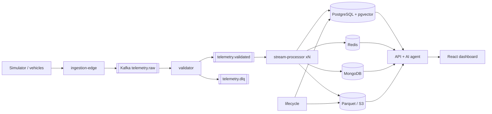

# Connected Vehicle Intelligence

**A multi-tenant fleet-intelligence platform**: it ingests telemetry from 100,000+ (synthetic) connected vehicles through Kafka, detects engine,
battery, driver-safety and security problems in seconds, predicts maintenance risk with a versioned ML model, and answers fleet questions through a
tool-using AI copilot with guardrails and a tamper-evident audit trail. Built for the Motorq *Connected Vehicle Intelligence* hackathon.

> **60-second tour** — `cp .env.example .env && docker compose up --build`, open <http://localhost:8080>, sign in as `fleet_manager@acme.demo` / `Demo@12345`,
> go to **Operations → Run `engine_failure`**, watch the alert appear on **Alerts** and the vehicle turn red on the **Live map**, open the vehicle, then ask the
> **AI Copilot** *"Explain why `<VIN>` is unhealthy"* (scenario output shows the VIN).

## Contents
1. [Problem and approach](#1-problem-and-approach) · 2. [Architecture](#2-architecture) · 3. [Features](#3-features) · 4. [Technology](#4-technology-stack) ·
5. [Repository layout](#5-repository-structure) · 6. [Quick start](#6-quick-start) · 7. [Configuration](#7-environment-variables) · 8. [Docker](#8-docker-setup) ·
9. [Database](#9-database-setup) · 10. [Simulator](#10-running-the-simulator) · 11. [Demo](#11-running-the-demo) · 12. [Tests](#12-running-tests) · 13. [Load tests](#13-running-load-tests) ·
14. [Security](#14-security) · 15. [Cloud](#15-cloud-deployment-aws-terraform) · 16. [Kubernetes](#16-kubernetes) · 17. [AI agent](#17-ai-agent) · 18. [Performance](#18-performance) ·
19. [Decisions](#19-architecture-decisions) · 20. [Known limitations](#20-known-limitations-read-this) · 21. [Hackathon deliverables](#21-hackathon-deliverables)

## 1. Problem and approach
Fleet operators drown in raw telemetry but need *decisions*: which vehicle will fail, which driver is dangerous, where is fuel wasted, what to do next.
The hackathon asks for an end-to-end, production-minded system: 100K-vehicle scale, real-time + batch analytics, polyglot persistence, security, observability,
resilience, containers/IaC/CI and an AI agent. This repository implements those with **depth over breadth**: a real streaming pipeline with exactly-once *effects*,
tenant isolation enforced in the database, an ML model evaluated against a baseline, and an agent whose every answer comes from tools.

## 2. Architecture

Details: [architecture](docs/architecture.md) · [data flow & delivery semantics](docs/data-flow.md) · [database / ER diagram](docs/database.md) · [scaling](docs/scaling.md).

## 3. Features
* **Simulator** (`cvi.simulator`): vectorised physics for 100,000 vehicles (~80K msg/s/process), VINs with valid check digits, ICE/EV/hybrid signals, DTCs, harsh events, idling,
  geofence exits; injects duplicates, out-of-order, late and malformed events, outages with recovery bursts, 3× bursts; modes `demo|small|load|100k`; 5 deterministic scenarios.
* **Ingestion**: HTTPS batch + MQTT bridge → Kafka; schema validation (Pydantic + JSON Schema), VIN ISO-3779 check, OBD-II decoding, DLQ with reasons, back-pressure.
* **Real-time analytics**: dedupe (atomic Redis Lua gate), event-time windows with bounded lateness, detectors for overheating, low oil pressure, repeated DTCs, EV battery SoH/thermal,
  dangerous driving, excessive idling (with cost), geofence/unexpected location, suspicious movement, sensor anomalies (EWMA z-score); health & driver-risk scores; alerts with confidence,
  cause and recommended action.
* **Predictive maintenance**: gradient-boosting model vs service-interval baseline (synthetic data, honestly labelled), top-factor explanations, batch scoring of all vehicles, model versioning.
* **Polyglot persistence**: PostgreSQL (3NF, RLS, pgvector), MongoDB (raw events, TTL), Redis (state/aggregates/limits/map cells), S3-compatible Parquet (warm/cold, DuckDB analytics).
* **API & UI**: REST (36 operations, keyset pagination), React dashboard — executive KPIs, live map (geofences, severity), vehicle pages (live signals, history, DTCs, prediction), analytics charts, alerts workflow, **AI Copilot**, operations (scenarios, audit, erasure).
* **AI Copilot**: 14 typed tools (fleet summary, health, alerts, telemetry search, driver risk, ML predictions, idle cost, A*-ETA nearest vehicle, pgvector knowledge search, knapsack maintenance plan, create/ack alert with confirmation), guardrails, grounding check, hash-chained audit, optional LLM narration.
* **Security**: JWT/OIDC, RBAC, PostgreSQL row-level security, rate limiting, secure headers, location masking, GDPR/DPDP erasure across tiers, audit chains.
* **Observability**: Prometheus metrics, JSON logs → Loki, OpenTelemetry → Jaeger, Grafana dashboard, SLO alert rules.
* **Resilience**: retries with backoff, circuit breakers, back-pressure, DLQ, idempotency, graceful degradation, health/readiness probes, chaos tests.
* **DevOps**: Dockerfiles, one-command Compose, Kustomize (HPA, PDB, NetworkPolicy, KEDA), Terraform (AWS), GitHub Actions (lint → tests → coverage → SAST → images → scans → deploy validation → e2e/DAST/load/chaos).

## 4. Technology stack
Python 3.12 (FastAPI, psycopg 3, confluent-kafka, redis-py, pymongo, PyArrow, DuckDB, scikit-learn, NumPy, Pydantic, PyJWT, bcrypt, prometheus-client, OpenTelemetry) ·
React 19 + TypeScript + Vite + Tailwind + Recharts + Leaflet · Apache Kafka · PostgreSQL 16 + pgvector · MongoDB 7 · Redis 7 · MinIO/S3 · Mosquitto ·
Prometheus, Grafana, Loki, Jaeger · Docker, Kustomize, Terraform (AWS: EKS, RDS, ElastiCache, MSK, DocumentDB, S3, KMS, Secrets Manager) · pytest, pytest-bdd, Vitest, k6, Locust.

## 5. Repository structure
```
├── src/cvi/                 one shared package, one image, many entry points
│   ├── simulator/ ingestion/ stream/ api/ agent/ ml/ lifecycle/   (services)
│   ├── algorithms/ messaging/ storage/ schemas/ synthetic/ common/ (libraries)
├── services/simulator/      `python simulator.py --vehicles 100000 --events-per-second 100000 --duration 300`
├── frontend/                React dashboard (Vite)
├── migrations/              ordered SQL (schema, pgvector, RLS, indexes/MVs, auth function, HNSW)
├── schemas/                 JSON Schemas (telemetry, alert, DLQ, agent, REST)
├── scripts/                 seed, e2e, sql_evidence, dev_postgres, gen_k8s, gen_dashboard, chaos_compose, security_report
├── ml/artifacts/            trained model + metrics.json (generated)
├── tests/                   unit · integration · contract · acceptance (BDD) · load (k6/Locust)
├── benchmarks/              reproducible performance scripts + results/*.json
├── infrastructure/          docker/ · kubernetes/ (base + overlays) · terraform/aws · observability/
├── docs/                    architecture, data-flow, database, security, algorithms, scaling, testing, deployment, ai-agent, ml, adr/, security/, performance/, solution-document, demo-script
├── .github/workflows/ci.yml · docker-compose.yml · Makefile · .env.example
```

## 6. Quick start
**Prerequisites:** Docker with Compose v2 (8 GB RAM recommended). Python/Node are only needed for development.
```bash
git clone <this repo> && cd connected-vehicle-intelligence
cp .env.example .env              # development defaults, synthetic data only
docker compose up --build         # first start seeds 100,000 vehicles (several minutes); set SEED_VEHICLES=5000 in .env for ~30 s
```
Then open **<http://localhost:8080>**. Demo accounts (password `Demo@12345`): `admin@`, `fleet_manager@`, `analyst@`, `viewer@` + `acme.demo` (Acme Logistics),
`borealis.demo` (Borealis EV Fleet), `metro.demo` (Metro Transit Authority). `analyst`/`viewer` see masked locations and cannot write.
Other UIs: API docs <http://localhost:8000/docs> · Grafana <http://localhost:3000> (admin/admin) · Prometheus :9090 · Jaeger :16686 · MinIO console :9001.

**Without Docker** (what this repo was developed on): `make setup`, `make local-db` (embedded PostgreSQL), `python scripts/seed.py --vehicles 5000`, `make local-up`
(API + validator + stream processor in one process, in-memory broker; use `REDIS_URL=redis://localhost:6379/1` for a real Redis), `cd frontend && npm run dev`.

## 7. Environment variables
`.env.example` lists every variable with a comment. Highlights:

| variable | default | purpose |
|---|---|---|
| `SEED_VEHICLES`, `SEED_HISTORY_ALERTS`, `SEED_HISTORY_DAYS` | 100000 / 200000 / 14 | size of the synthetic dataset |
| `SIM_MODE`, `SIM_VEHICLES`, `SIM_EVENTS_PER_SECOND` | demo / 1000 / 150 | simulator started by the `sim` compose profile |
| `JWT_SECRET`, `INGEST_API_KEY`, `*_PASSWORD` | dev values | **replace outside a laptop** |
| `ALLOWED_LATENESS_S`, `TOPIC_PARTITIONS`, `WORKER_BATCH_SIZE`, `SNAPSHOT_INTERVAL_S` | 300 / 12 / 500 / 15 | pipeline tuning |
| `RATE_LIMIT_PER_MINUTE` | 600 | API limit per token/IP |
| `OIDC_JWKS_URL` | empty | accept RS256 tokens from an external IdP |
| `ANTHROPIC_API_KEY` | empty | optional LLM narration of agent answers (agent works without it) |
| `OTLP_ENDPOINT` | `http://jaeger:4318` | OpenTelemetry traces |

## 8. Docker setup
19 containers: stores (Postgres+pgvector, Redis, MongoDB, MinIO, Kafka KRaft, Mosquitto), `init` (migrate + seed + score), services (`api`, `ingestion-edge`, `validator`,
`stream-processor`, `lifecycle`, `simulator`), `frontend` (nginx), observability (Prometheus, Grafana, Loki, Promtail, Jaeger). All have health checks; start order uses `service_healthy`.
Scale consumers: `docker compose up -d --scale stream-processor=3 --scale validator=2`. `make up/down/logs/clean` wrap the common commands.

## 9. Database setup
Automatic: the `init` job runs `scripts/seed.py` → applies `migrations/*.sql` (advisory-locked, idempotent), creates roles `cvi_app` (RLS enforced) and `cvi_worker`, loads tenants/users/
fleets/**100,000 vehicles**/drivers/maintenance/14 days of daily stats/knowledge base, trains the model if absent and scores every vehicle. Manual: `make seed` (full) / `make seed-small`.
Schema, ER diagram, indexes and RLS: [docs/database.md](docs/database.md).

## 10. Running the simulator
```bash
python services/simulator/simulator.py --vehicles 100000 --events-per-second 100000 --duration 300 --workers 8 --sink kafka   # 100K-vehicle load
python services/simulator/simulator.py --mode demo                                                                              # 1,000 vehicles, 300 ev/s
python services/simulator/simulator.py --mode small --sink http --burst 60:10:3                                                 # 3x burst for 10 s each minute
python services/simulator/simulator.py scenarios                                                                                # list scenarios
make scenario S=engine_failure                                                                                                  # deterministic scenario
```
Modes: `demo` (1K vehicles, 300/s), `small` (10K, 2K/s), `load` (100K, 20K/s, 2 workers), `100k` (100K, 100K/s, CPU-count − 1 workers). Sinks: `kafka`, `http` (edge), `mqtt`, `stdout`, `null`.
Fault injection (default on; `--no-chaos` disables): 1% duplicates, 2% out-of-order, 0.3% late (beyond the lateness bound), 0.3% malformed.
Generation throughput measured here: [~80K msg/s per process, 213K with 4 workers](docs/performance/benchmarks.md) — enough to *generate* 100K/s; sustaining it end to end needs a Kafka cluster and scaled consumers.

## 11. Running the demo
Step-by-step script (with what to say/show): [docs/demo-script.md](docs/demo-script.md). Scenarios (Operations page, or `make scenario`):

| scenario | vehicle | pipeline result |
|---|---|---|
| `engine_failure` | diesel van (Acme) | coolant > 110 °C, P0301/P0217 repeating, oil pressure collapses → critical `engine_overheating`, `repeated_dtc`, `low_oil_pressure`; health < 40; copilot explains |
| `dangerous_driver` | petrol pickup (Acme) | speeding + harsh braking/acceleration → risk score 100, critical `dangerous_driving` |
| `ev_battery` | EV van (Borealis) | SoH 79→70 %, pack > 55 °C → `battery_degradation` (critical < 70 %), `battery_thermal` |
| `fleet_idling` | 6 buses (Metro) | 15+ min idling each → `excessive_idling` with litres and USD; ask "How much money could we save by reducing idling?" |
| `suspicious_movement` | EV (Borealis) | moving with ignition off → critical alert |
Re-trigger after ~5 minutes (alert cool-down buckets) or use `make seed` to reset. `scripts/e2e.py` automates the whole demo against a running stack and prints measured latencies.

## 12. Running tests
```bash
make setup && make test            # 174 passed, 2 skipped (Kafka/Mongo need real services; CI runs them)
make coverage                      # 86.5% line coverage, gate 80%
cd frontend && npm test            # 5 tests
make lint                          # ruff + mypy + tsc
```
Layers, what each proves, and how faking is avoided: [docs/testing.md](docs/testing.md). Contract schemas: `schemas/`.

## 13. Running load tests
```bash
k6 run -e BASE=http://localhost:8001 -e RATE=100 -e BATCH=1000 tests/load/k6_ingest.js   # steady + 3x burst; 100 it/s x 1000 = 100K events/s
k6 run -e BASE=http://localhost:8000 tests/load/k6_api.js                                  # API p95<200ms, p99<500ms thresholds
python benchmarks/bench_pipeline.py && python benchmarks/bench_api.py                      # reproducible local benchmarks (JSON in benchmarks/results)
```
**Be aware:** the 100K events/s run itself was *not* executed (see §20); local single-replica measurements and a clearly labelled capacity model are provided.

## 14. Security
JWT/OIDC, RBAC with tenant isolation (**PostgreSQL RLS** + composite FKs + scoped keys), rate limiting, input validation, secure headers, CORS allow-list, bcrypt, hash-chained audit logs,
agent guardrails, location masking, erasure workflow, secrets via env/Secrets Manager. Threat model: [STRIDE](docs/security/stride-threat-model.md) · controls & OWASP API Top 10 mapping:
[docs/security.md](docs/security.md) · scanner output (Bandit 0 medium/high, pip-audit/npm audit clean, ruff/mypy clean): [docs/security/scan-results.md](docs/security/scan-results.md).

## 15. Cloud deployment (AWS / Terraform)
`infrastructure/terraform/aws` provisions VPC, EKS, RDS (Multi-AZ + replica), ElastiCache, MSK, DocumentDB, S3 (lifecycle tiers), KMS, Secrets Manager, IAM (IRSA), ingress NLB, KEDA,
External Secrets and CloudWatch alarms. `terraform init && terraform apply` (use the `dev` profile in `terraform.tfvars.example` to limit cost). The application is cloud-agnostic
(Kafka protocol, S3 API, Postgres/Redis/Mongo URLs, OIDC); GCP/Azure mapping in [docs/deployment.md](docs/deployment.md). *Terraform was HCL-parsed locally but not `validate`d/applied (CI does `validate`).*

## 16. Kubernetes
`kubectl kustomize infrastructure/kubernetes/overlays/dev | kubectl apply -f -` (kind/minikube) or `overlays/aws`. Deployments with probes, resource limits, hardened security contexts, HPAs (KEDA on Kafka lag for
stream processors in AWS), PDBs, NetworkPolicies, Ingress with TLS, init Job for migrations/seed. Manifests are generated by `scripts/gen_k8s.py` and statically checked by tests; not applied to a live cluster here.

## 17. AI agent
`POST /api/v1/agent/chat` — intent → tool plan → permission/argument checks → tenant-scoped execution → answer from tool output (+ optional grounded LLM wording) → audit.
Ask: *Which vehicles are at highest maintenance risk? · Why is fleet utilization down today? · Show vehicles with abnormal battery degradation. · Which vehicles have repeated engine faults? ·
What actions should the fleet manager take? · How much money could we save by reducing idling?* Writes (create/acknowledge alert) require a confirmation token. Full design: [docs/ai-agent.md](docs/ai-agent.md), [ADR-004](docs/adr/ADR-004-ai-agent-architecture.md).

## 18. Performance
All figures measured on one laptop (AMD 16 threads, 15.8 GB, Windows) with real PostgreSQL (100K vehicles, 1M alerts) and Redis 3.0; Kafka and MongoDB were **not** in the loop:

| what | result |
|---|---|
| simulator generation | 79.5K msg/s (1 process), 213K msg/s (4 processes) |
| validator | 32K msg/s per process |
| stream processor (real Redis + PostgreSQL sink) | **4.5K events/s per process** (225 µs/event); 6.6K with an in-memory sink; aggregates exactly equal distinct events despite 1% duplicates |
| API (16 concurrent clients, 1 process) | p95 29–91 ms, p99 64–119 ms across endpoints; 190–570 req/s/endpoint |
| alert latency (event → alert) | 0.8–1.8 s for the four demo scenarios |
| SQL | 243.8 → 0.4 ms (alert feed), 583.8 → <0.05 ms (KPI trend), 277 s → 92 ms (top risk, no-index LATERAL plan), N+1 42.9 → 1.6 ms |

Capacity model for 100K events/s (**theoretical**: 48 partitions/replicas): [docs/performance/benchmarks.md](docs/performance/benchmarks.md); real plans: [docs/performance/sql-before-after.md](docs/performance/sql-before-after.md).

## 19. Architecture decisions
[ADR-001 Kafka vs RabbitMQ](docs/adr/ADR-001-kafka-vs-rabbitmq.md) · [ADR-002 Polyglot persistence](docs/adr/ADR-002-polyglot-persistence.md) · [ADR-003 Stream processing](docs/adr/ADR-003-stream-processing.md) ·
[ADR-004 AI agent](docs/adr/ADR-004-ai-agent-architecture.md) · [ADR-005 Data lifecycle](docs/adr/ADR-005-data-lifecycle.md). CAP/PACELC table in [architecture.md](docs/architecture.md#6-cap--pacelc-classification).

## 20. Known limitations (read this)
Honest status of what was verified and what was not:

| Area | Status |
|---|---|
| Pipeline logic, detectors, idempotency, ordering, DLQ, failure handling | **Verified**: 176 tests, 86.5% coverage, real PostgreSQL (RLS, constraints) and real Redis (Lua), chaos tests |
| End-to-end demo on the 100K dataset | **Verified** with `scripts/e2e.py` in the embedded stack (in-memory broker; real PostgreSQL + Redis) |
| **Docker Compose stack, Kafka adapter, MongoDB adapter, MinIO/S3 adapter, MQTT bridge** | **Authored and statically validated only** — Docker was not available on the build machine. The adapters implement the same interfaces the tests exercise through in-memory doubles; real-service tests exist (`test_kafka_mongo.py`) and run in CI. Expect to fix small integration issues on first `docker compose up` |
| Kubernetes manifests, Terraform | statically validated (YAML/HCL parse, invariants); not applied (CI runs `terraform validate`, kubeconform) |
| **100K events/s sustained** | **Not demonstrated.** Generation can exceed it; the processing path was measured per replica (4.5K/s) and extrapolated (documented as theoretical) |
| DAST, Trivy image scan, Semgrep | configured in CI; not run locally |
| ML | trained on **synthetic** data with a hidden-wear generator: shows the method, not real-world accuracy |
| pgvector locally | the embedded Windows PostgreSQL's pgvector build crashes on SIMD distance code, so local runs use `VECTOR_BACKEND=python`; Docker/CI use real pgvector + HNSW |
| Redis locally | tests/benchmarks ran against Redis 3.0.504; the code targets Redis ≥ 5 features only through `EVALSHA`, pipelines, sets/zsets/hashes/HLL |
| Agent | keyword intent routing; single-turn; LLM narration implemented but not exercised without an API key |
| Auth | seeded users only; no MFA/reset; single shared device key (mTLS documented, not implemented) |
| Detectors' windows | in-process (rebuild after restart) |
| Embedded dev mode | uses in-memory broker/Redis/Mongo emulators — never in deployed services |
The hackathon problem-statement PDF was not available in the working directory; requirements were taken from the task text that summarises it.

## 21. Hackathon deliverables
| Deliverable | Where |
|---|---|
| Solution document (21 sections, AI/OSS disclosure) | [docs/solution-document.md](docs/solution-document.md) |
| Git repository, one-command Compose | this repo, `docker-compose.yml` |
| Seeded 100K-vehicle dataset | `scripts/seed.py` (executed: 100,000 vehicles, 1M alerts, 1.04M daily rows, 100K predictions) |
| Architecture diagram, 3NF ER diagram, sequence diagrams | [architecture](docs/architecture.md), [database](docs/database.md), [ai-agent](docs/ai-agent.md) |
| ADRs (5) | `docs/adr/` |
| End-to-end demo + script | `scripts/e2e.py`, [demo-script](docs/demo-script.md) |
| Coverage / load / security evidence | [testing](docs/testing.md), [benchmarks](docs/performance/benchmarks.md), [scan results](docs/security/scan-results.md) |
| SQL before/after plans | [sql-before-after](docs/performance/sql-before-after.md) |
| CI pipeline, Dockerfiles, Kubernetes, Terraform | `.github/workflows/ci.yml`, `infrastructure/` |
| STRIDE threat model | [docs/security/stride-threat-model.md](docs/security/stride-threat-model.md) |
| Algorithms analysis | [docs/algorithms.md](docs/algorithms.md) |
