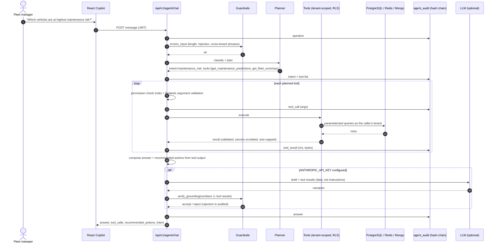

# AI Fleet Copilot (agent)

Design decision record: `docs/adr/ADR-004-ai-agent-architecture.md`. Code: `src/cvi/agent/*`, API: `src/cvi/api/routers/agent.py`,
UI: `frontend/src/pages/Copilot.tsx`.

## Request flow

## Tools (`GET /api/v1/agent/tools` shows what the caller may use)

| tool | permission | reads | notes |
|---|---|---|---|
| `get_fleet_summary` | analytics:read | dashboard KPIs (same cached query as the UI) | |
| `get_vehicle` / `get_vehicle_health` | vehicles:read | vehicle, live state, health factors, driver risk, ML prediction, open alerts | location masked without `location:precise` |
| `get_recent_alerts` | alerts:read | open alerts by severity/type/VIN | |
| `search_telemetry` | telemetry:read | MongoDB raw telemetry statistics + DTC counts for a VIN/window | |
| `get_driver_risk` | analytics:read | highest risk scores | |
| `get_maintenance_predictions` | analytics:read | latest ML prediction per vehicle with top factors | states that the model is trained on synthetic data |
| `calculate_idle_cost` | analytics:read | `daily_vehicle_stats` idle seconds → litres → cost, saving % and annualised | returns assumptions (L/h, price) |
| `get_utilization_analysis` | analytics:read | 8-day KPI view + maintenance/critical context | used for "why is utilisation down" |
| `find_nearby_vehicle` | vehicles:read | Redis geohash cells + A* ETA on a street grid | |
| `search_knowledge_base` | vehicles:read | pgvector: runbooks/DTC guides + similar past incidents | |
| `recommend_maintenance_plan` | analytics:read | knapsack DP over ML risk and workshop hours | |
| `create_alert` | agent:act | **writes** | needs confirmation |
| `acknowledge_alert` | agent:act | **writes** | needs confirmation |

## Supported questions (all exercised by `tests/integration/test_api.py` and the BDD scenarios)
* Which vehicles are at highest maintenance risk? → ML ranking + drivers of risk + fleet-wide count; actions: inspect top 3 within 48 h.
* Why is fleet utilisation down today? → compares today's active vehicles to the previous-days average from the KPI view and lists the data-backed factors (vehicles in maintenance, vehicles with critical alerts, idle hours/cost).
* Show vehicles with abnormal battery degradation. → open `battery_degradation` alerts + highest predicted risk; or a single vehicle's SoH telemetry.
* Which vehicles have repeated engine faults? → `repeated_dtc` alerts grouped by VIN with the codes and knowledge-base guidance.
* What actions should the fleet manager take? → prioritised plan: critical alerts, top-risk vehicles, driver coaching, idle policy (with estimated saving).
* How much money could we save by reducing idling? → idle hours (7 d) × L/h × price, saving at 30% reduction, annualised; test checks the figure equals the database.
* "Explain why `<VIN>` is unhealthy", "Which drivers are dangerous?", "Schedule maintenance with 24 workshop hours", "Create an alert for `<VIN>` …".

## Guardrails
| Layer | Control |
|---|---|
| Input | ≤ 1000 chars, printable only, phrases such as *ignore previous instructions*, *other tenants*, *drop table*, *reveal system prompt* are refused (audited as `guardrail`) |
| Authorisation | tool → permission map; analysts/viewers cannot invoke write tools; `/agent/confirm` requires `agent:act` |
| Arguments | Pydantic models (VIN regex, bounds on limits/days/percentages); invalid → refused, audited |
| Execution | tenant context + RLS; no free-form SQL; max 6 tool calls per question; per-user rate limit (20/min) |
| Output | secret-like keys stripped, 200 kB cap; answers built from tool results only |
| Hallucination | deterministic composer; optional LLM text must pass `verify_grounding` (every number traceable to tool results) |
| Destructive actions | propose → single-use 5-min token bound to the user → confirm → execute → audit |
| Audit | hash-chained `agent_audit`; `GET /agent/audit` returns `chain_valid` for admins |

## Estimating impact
Impact numbers come from tools, never from the language layer: idle cost/saving (`calculate_idle_cost`), expected failures avoided by
the maintenance schedule (`recommend_maintenance_plan`), failure probability and fleet counts (`get_maintenance_predictions`).
Assumptions are returned with every figure (fuel price and idle burn rate are configuration: `FUEL_PRICE_PER_LITRE`, `IDLE_FUEL_LPH`).

## Limitations (honest)
* Intent routing is keyword based; unusual phrasing falls back to the fleet overview.
* Single-turn: the session id groups audit entries but no conversational memory is used for planning.
* The ML model behind maintenance answers is trained on **synthetic** data; the agent says so in the tool output.
* LLM narration was implemented and unit-tested at the grounding layer but not exercised against the live API in this build (no key).
