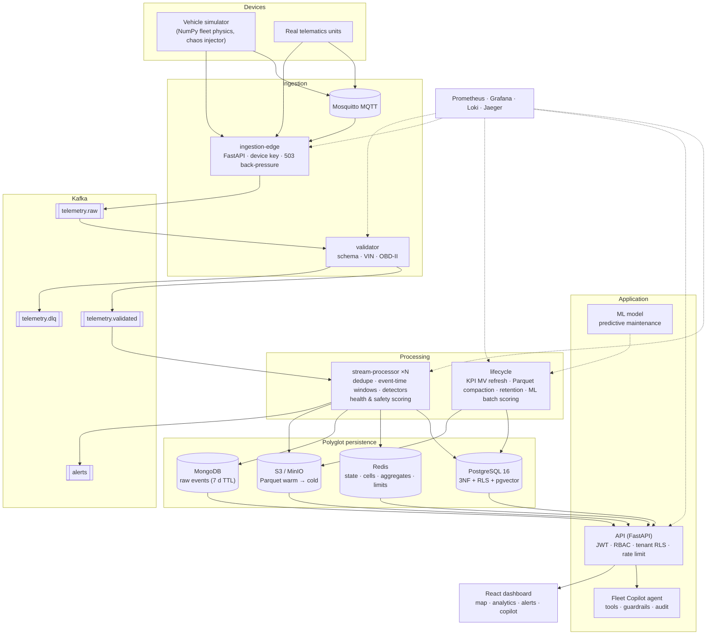
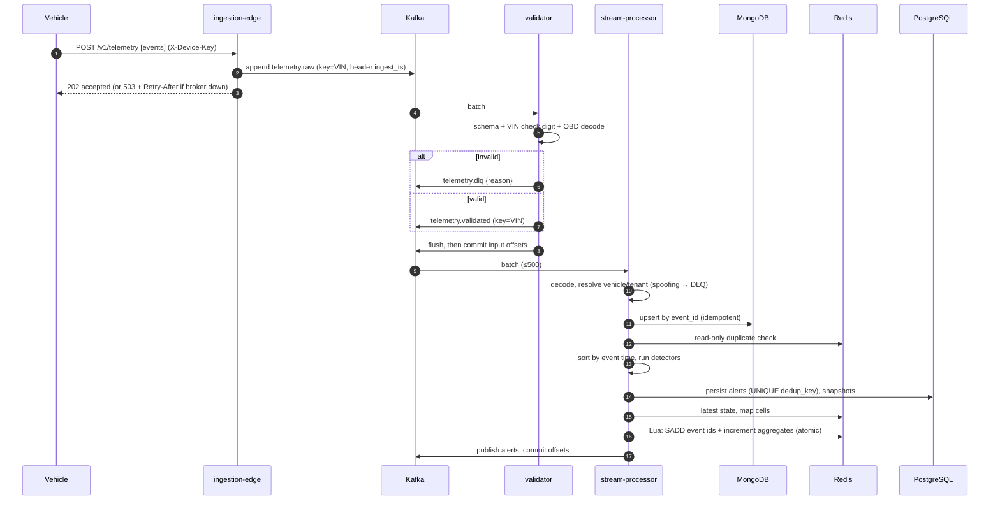
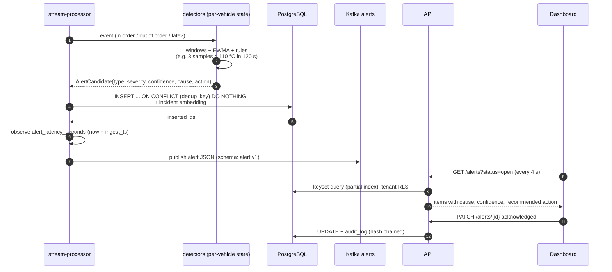

# Architecture

## 1. Product
**Connected Vehicle Intelligence** is a multi-tenant SaaS for fleet operators. It ingests telemetry from 100,000+ connected vehicles, detects
vehicle-health, driver-safety, fleet and security problems in seconds, predicts maintenance risk with an ML model, and lets managers ask
an AI copilot questions that are answered from live data with an auditable action trail.

Tenancy model: `Tenant → Fleets → Vehicles / Drivers → Trips / Alerts`; three seeded tenants (Acme Logistics — diesel/petrol vans; Borealis EV
Fleet; Metro Transit Authority — hybrid/diesel buses) share 100,000 vehicles.

## 2. System architecture

## 3. Services and responsibilities
| Service (module) | Responsibility | State | Scales by |
|---|---|---|---|
| `ingestion-edge` (`cvi.ingestion.gateway`) | HTTPS batch endpoint + MQTT bridge; auth, size limit, durable append to `telemetry.raw`; 503 + `Retry-After` when Kafka is unhealthy | stateless | replicas behind LB |
| `validator` (`cvi.ingestion.validator`) | JSON-Schema/Pydantic validation, VIN check digit, OBD-II decoding, future-timestamp check; invalid → DLQ with reason | stateless | consumer group |
| `stream-processor` (`cvi.stream.*`) | dedupe, event-time ordering, detectors, alerts, health/safety scores, Redis state, Mongo/Parquet writes, aggregates | per-vehicle windows in memory (rebuilt after restart) | consumer group (≤ partitions) |
| `lifecycle` (`cvi.lifecycle`) | KPI materialised-view refresh, Parquet compaction + retention, ML batch scoring | locks in Redis | 1–2 replicas |
| `api` (`cvi.api`) | REST API, auth, RBAC, tenant isolation, analytics, agent endpoints, demo scenarios, erasure | stateless | replicas (HPA) |
| agent (`cvi.agent`) | tools, guardrails, audit; runs inside the API process under the caller's identity | — | with API |
| simulator (`cvi.simulator`) | 100K-vehicle generator, fault/chaos injection, deterministic scenarios | in-process | `--workers` |
| frontend | nginx-served SPA, same-origin proxy to API | — | replicas |

Why a modular monolith for the application layer (API+agent) but separate processes for ingestion/validation/stream/lifecycle? Those
are the units that scale, fail and deploy differently (CPU-bound consumer groups vs request/response), while splitting API and agent
would add network hops without an independent scaling need. All Python services share one library package (`src/cvi`) and one image.

## 4. Sequence — telemetry ingestion

## 5. Sequence — alert generation and consumption

The agent request sequence is in `docs/ai-agent.md`.

## 6. CAP / PACELC classification

PACELC reads: *if Partitioned choose Availability or Consistency; Else choose Latency or Consistency*.

| Data | Class | CAP (P) | PACELC (E) | Why / mechanism |
|---|---|---|---|---|
| Billing/subscriptions, plans | strong | **C** | C | money; PostgreSQL primary, synchronous Multi-AZ standby; reject writes rather than diverge |
| Tenants, fleet ownership, vehicles, users, roles | strong | **C** | C | access control and ownership must never be stale: a revoked user must lose access immediately; FKs + RLS |
| Authentication tokens, refresh revocation | strong-ish | C (Redis `SADD` revocation; if Redis is down refresh reuse cannot be detected — degrade to short access TTL) | L | 15-minute access tokens bound the exposure |
| Audit logs (hash chain) | strong, append-only | C | C | tamper evidence needs a total order per tenant (advisory lock per tenant chain) |
| Alerts (system of record) | strong | C | C | one row per `dedup_key`; operators act on them |
| Raw telemetry (Kafka → Mongo/Parquet) | eventual | **A** | L | losing availability on ingestion is worse than a few seconds of replication lag; idempotent replays reconcile |
| Latest vehicle state, map | eventual | A | L | Redis; may lag the stream by < 1 s; self-heals with the next event |
| Real-time dashboard aggregates | eventual | A | L | Redis counters + 2–30 s caches; the executive KPI view is explicitly approximate-fresh |
| Daily/KPI rollups, ML predictions | eventual, batch | A | L | recomputed from facts; absolute upserts |
| Vector/knowledge search | eventual | A | L | embeddings written after the alert; missing a fresh incident is harmless |
Trade-off in one line: **PostgreSQL = CP/EC for business truth; Kafka/Redis/Mongo/object store = AP/EL for the firehose** with idempotency as the reconciliation tool.

## 7. Multi-tenancy
* Identity carries `tenant_id`; every query includes it (application filter), PostgreSQL RLS enforces it again (`FORCE ROW LEVEL SECURITY`, non-owner role),
  composite FKs make cross-tenant references impossible, Redis keys and Parquet paths include the tenant slug, the agent runs inside the caller's
  tenant context, and foreign objects answer 404.
* Isolation is **tested**: `tests/integration/test_database.py` (RLS), `test_api.py` (object-level access, filter abuse, agent), BDD "Tenants are isolated".
* Noisy-neighbour controls: per-token rate limiting, per-tenant Redis keys, keyset pagination.

## 8. Cloud-agnostic design
No cloud SDK is imported by business logic. Boundaries: `Broker` (Kafka protocol), `ObjectStore` (S3 API; MinIO/GCS-interop/Azure gateway), PostgreSQL URL, Redis URL
(`rediss://`), Mongo URL, JWT validation (HS256 locally, RS256 via `OIDC_JWKS_URL` for any OIDC IdP), OTLP for traces, Prometheus for metrics. Terraform targets AWS;
`docs/deployment.md` maps each component to GCP/Azure equivalents.

## 9. Observability
Metrics (Prometheus): `events_received_total`, `events_processed_total`, `events_failed_total`, `dlq_messages_total`, `events_duplicate_total`,
`events_out_of_order_total`, `events_late_total`, `alerts_generated_total`, `processing_latency_seconds`, `alert_latency_seconds`, `consumer_lag`,
`vehicles_active`, `circuit_breaker_open`, `backpressure_pauses_total`, `api_request_latency_seconds`, `api_requests_total`, `agent_tool_calls_total`.
Logs: one JSON object per line (`ts, level, logger, msg, …`) → Promtail → Loki. Traces: OpenTelemetry FastAPI instrumentation → OTLP → Jaeger.
Grafana dashboard `CVI — Pipeline & API overview` (generated by `scripts/gen_dashboard.py`) and Prometheus alert rules for the SLOs.

## 10. Failure behaviour (what happens when…)
| Failure | Behaviour | Test |
|---|---|---|
| Kafka down | edge returns 503 + `Retry-After`; validator/processor loops stay alive and resume; no data accepted ⇒ none lost | `test_edge_applies_back_pressure_when_broker_is_down`, `test_validator_survives_a_broker_outage_and_resumes` |
| PostgreSQL down | processor pauses consumption, retries the same batch with back-off, does not commit; API `/health/ready` → 503; recovery delivers the alert once | `test_database_outage_applies_back_pressure_then_recovers_*` |
| Redis down | API: in-process rate limiter, `degraded` readiness, reads from PostgreSQL; processor: Bloom-filter dedupe, aggregates/state skipped (logged) | `test_redis_outage_degrades_the_api_instead_of_failing`, `test_redis_outage_degrades_to_bloom_dedupe_*` |
| MongoDB down | back-pressure (raw events are the system of record for telemetry) | `test_mongo_outage_applies_back_pressure` |
| Object store down | Parquet buffered and retried; back-pressure only past 4× flush size | `test_object_store_outage_is_buffered_not_fatal` |
| Consumer crash mid-batch | restart re-reads uncommitted offsets; duplicates neutralised | `test_consumer_crash_mid_batch_then_restart_is_exactly_once_in_effect` |
| API instance dies | stateless; tokens valid on any replica; refresh rotation shared via Redis | `test_api_instance_death_is_invisible_to_clients` |
| Duplicate / reordered / late events | gate, event-time windows, lateness bound | processor unit tests, BDD scenario |
| Container kill in a real stack | `scripts/chaos_compose.sh` (CI job `e2e`) | — |
