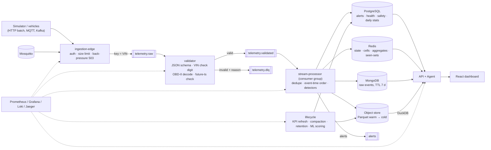

# Data flow, delivery semantics, idempotency, ordering and partitioning

## 1. End-to-end flow

## 2. Event contract (`schemas/telemetry.v1.schema.json`)
`event_id` (idempotency key, `<vin>-<seq>` from the simulator), `tenant`, `vin`, `seq` (per-vehicle monotonic counter), `ts` (device
event time, epoch ms), position, speed, odometer, powertrain-specific signals (fuel level, coolant/oil temperature, oil pressure,
rpm, voltage, vibration, battery SoC/SoH/temperature), `dtc[]`, flags (`harsh_brake`, `harsh_accel`, `idling`, `speeding`,
`engine_on`), `trip_id`, optional raw OBD frame. `extra="forbid"`: unknown fields are rejected. The JSON Schema file is generated from
the Pydantic model, checked into the repo and pinned by a contract test; `alerts`, DLQ and agent responses have their own schemas.

DLQ reasons: `malformed`, `schema_violation`, `invalid_vin`, `timestamp_in_future`, `obd_parse_error`, `unknown_vehicle`,
`tenant_mismatch`, `processing_error` (poison message isolated by bisection).

## 3. Delivery semantics
| Hop | Guarantee | How |
|---|---|---|
| device → edge | at-least-once | device retries on 5xx/503 (honouring `Retry-After`); the simulator's HTTP sink does exactly this |
| edge → `telemetry.raw` | at-least-once | idempotent Kafka producer (`acks=all`); edge returns 202 only after enqueue, 503 when the broker is unhealthy |
| validator | at-least-once, deterministic | outputs flushed *before* input offsets are committed; stateless, so replays re-emit identical messages |
| stream processor | at-least-once delivery, **effectively-once effects** | see §4 |
| API reads | eventually consistent with the stream (typically < 1 s; alerts < 5 s end-to-end target) | |

## 4. Idempotency mechanisms (one per side effect)
| Side effect | Idempotency mechanism |
|---|---|
| MongoDB raw event | `_id = event_id` upsert |
| Parquet file | content-addressed file name (`part-<sha256 of ids>`) → rewrite is an overwrite; compaction de-duplicates by `event_id` |
| Alert row | `UNIQUE dedup_key = "<vin>:<type>:<severity>:<event_time_bucket>"` + `ON CONFLICT DO NOTHING`; bucket = `event_ts / ALERT_COOLDOWN_S` (also the alert-storm limiter) |
| Health/safety snapshot | upsert of the latest value |
| Daily vehicle stats | **absolute** values read from Redis and upserted (never "+= delta") |
| Redis aggregates | the `SADD` of the same Lua script that increments them is the gate → counted once even across restarts/replicas |
| Latest state | only events at least as new as the vehicle's `last_ts` overwrite it |
| In-process detector state | per-vehicle result cache by `event_id`: a retried batch re-emits the same alerts instead of double-counting windows |

Duplicate example (`event A, event A`): the second copy is dropped by the in-batch set or the Redis gate (`events_duplicate_total`),
tested in `test_duplicate_event_is_processed_once` and, across a simulated crash, in `test_replayed_batch_after_crash_does_not_double_count`.

## 5. Out-of-order and late events (`event 103, 101, 102`)
Event time is authoritative. Per vehicle:
1. a batch is sorted by `(ts, seq)` before detection, so `103, 101, 102` inside one batch is processed as `101, 102, 103`;
2. across batches an event older than `last_ts` but within `ALLOWED_LATENESS_S` is **out of order**: windows insert it at the right
   place, aggregates count it, latest-state is *not* regressed (`events_out_of_order_total`);
3. older than the lateness bound is **late**: kept in Mongo/Parquet for history, excluded from windows and aggregates, counted
   (`events_late_total`). Network-recovery bursts of old data therefore cannot rewrite the present.
Tests: `test_out_of_order_events_are_windowed_by_event_time`, `test_event_arriving_after_a_newer_one_is_out_of_order_not_dropped`,
`test_event_older_than_allowed_lateness_is_counted_but_not_applied`.

## 6. Partitioning strategy
| Layer | Partition / shard key | Why | Query strategy |
|---|---|---|---|
| Kafka | key = **VIN** (48 partitions in K8s, 12 in compose) | per-vehicle ordering; uniform hash of 100K keys ⇒ no hot partition; tenant key would skew by tenant size; time key would make "now" hot | consumer group members ≤ partitions |
| MongoDB | shard key `{tenant: 1, vin: hashed}`; indexes `(vin, ts↓)`, `(tenant, ts↓)`; TTL on `ingested_at` | tenant locality + even spread; vehicle history reads hit one shard | `recent(vin, since_ts)` |
| Object store | `tenant=/date=/hour=` prefixes; vehicle = sort key inside the file | time + tenant pruning, retention by prefix, erasure by tenant; avoids millions of tiny files | DuckDB reads only the needed `date=` folders, filters `vin` using row-group statistics |
| PostgreSQL | `tenant_id` leading column in indexes + RLS; `daily_vehicle_stats (vehicle_id, day)` PK; time partitioning of `alerts`/`audit_log` is the documented next step at > 100M rows (declarative partitions by month) | tenant isolation + locality | keyset pagination |
| Redis | per-vehicle keys; per-tenant aggregate keys; Redis Cluster hash-tags are not needed because scripts touch ≤ 4 keys that share the vehicle/tenant hour (single-node in dev; cluster mode would require `{tenant}`/`{vin}` hash tags — noted in docs/scaling.md) | | |

## 7. Back-pressure map
`device → (503 + Retry-After) edge`, `Kafka lag absorbs bursts`, `consumer pauses + retries the same batch when a sink is down`,
`circuit breakers (redis/mongo/postgres/objects)`, `bounded Parquet buffer (4 × flush size) then SinkUnavailable`, `API rate limit 429`.

## 8. Replay
Stop `stream-processor`, reset offsets of group `stream-processor` on `telemetry.validated` (or `validator` on `telemetry.raw`), start again.
Aggregates will not double count (gate), alerts will not duplicate (dedup key), history files are overwritten identically. To re-drive
DLQ messages after fixing a bug, consume `telemetry.dlq`, re-publish the `value` field to `telemetry.raw`.
