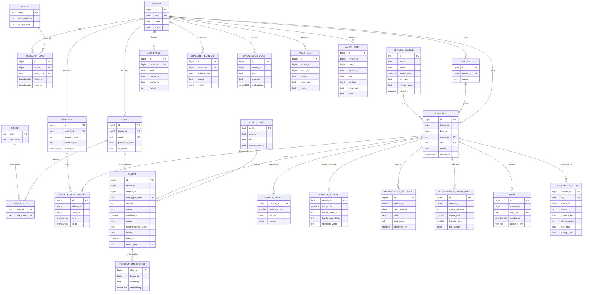

# Database design

## 1. Relational schema (PostgreSQL, 3NF)

### 3NF argument
* Every non-key attribute depends on the key, the whole key and nothing but the key. Repeating facts are factored out:
  vehicle make/model/year/fuel/capacity → `vehicle_models`; plan price/limits → `plans`; role descriptions → `roles`;
  alert type title/category/default severity → `alert_types`; the many-to-many user↔role → `user_roles`; driver↔vehicle over
  time → `vehicle_assignments`.
* `alerts.severity` is *not* derivable from the alert type alone (a detector may escalate), so it is a legitimate attribute of the
  alert rather than a transitive dependency; `default_severity` lives on the type.
* **Deliberate, documented denormalisations** (CQRS read models maintained by the stream processor; each is a projection that can be
  rebuilt from events): `vehicle_health`, `vehicle_safety`, `daily_vehicle_stats`, `mv_fleet_daily_kpis`, and `tenant_id` repeated on
  child tables.
* **Why `tenant_id` is repeated on children:** it enables row-level security policies and composite foreign keys
  `(vehicle_id, tenant_id) → vehicles(id, tenant_id)` that make it *impossible* to attach a record to a vehicle of another tenant
  (tested in `test_composite_foreign_key_prevents_cross_tenant_vehicle_fleet_mix`).

### Constraints
Primary keys everywhere; unique `vin`, `email`, `slug`, `dedup_key`, `(tenant_id, name)`; `CHECK` on statuses, severities, score
ranges (0–100), probabilities (0–1), slug pattern, positive radii and `ends_at > starts_at`; foreign keys with `ON DELETE CASCADE`
only where the child has no meaning without the parent.

## 2. Migrations
Plain, ordered SQL files in `migrations/` applied by `cvi.storage.pg.migrate` (tracked in `schema_migrations`, guarded by an advisory
lock so concurrent starts are safe, creates the least-privilege roles):

| file | content |
|---|---|
| `0001_core_schema.sql` | all tables, FKs, checks |
| `0002_vector.sql` | `CREATE EXTENSION vector`, embedding tables |
| `0003_row_level_security.sql` | RLS policies (`FORCE ROW LEVEL SECURITY`) per tenant table |
| `0004_performance.sql` | composite/partial indexes, `mv_fleet_daily_kpis`, `latest_maintenance_predictions` view |
| `0005_auth_functions.sql` | `SECURITY DEFINER auth_lookup()` so login can find a user before a tenant context exists |
| `0006_vector_hnsw.sql` | HNSW cosine indexes (skippable via `SKIP_VECTOR_INDEX` on hosts whose pgvector build cannot run SIMD code) |

Roles: `cvi` (owner; migrations/seed only), `cvi_app` (API: `NOBYPASSRLS`, INSERT-only on audit tables), `cvi_worker`
(stream/lifecycle: `BYPASSRLS`, no UPDATE/DELETE on audit tables).

## 3. Indexing and query design
See `docs/performance/sql-before-after.md` for measured plans. Summary of the index set (`0004`):

| index | serves |
|---|---|
| `alerts (tenant_id, created_at DESC, id DESC)` | alert feed, keyset pagination |
| `alerts (tenant_id, severity, created_at DESC, id DESC) WHERE status='open'` (partial) | dashboard open-alert widgets, critical feed |
| `alerts (vehicle_id, created_at DESC)` | vehicle detail, ML feature SQL |
| `vehicles (tenant_id, status, id)`, `(tenant_id, fleet_id, id)` | vehicle list filters + keyset |
| `maintenance_predictions (vehicle_id, predicted_at DESC)`, `(tenant_id, failure_prob DESC)` | latest-per-vehicle, risk ranking |
| `maintenance_records (vehicle_id, performed_at DESC)` | last-service lookups (found via a real O(n²) feature query during seeding) |
| `daily_vehicle_stats (tenant_id, day)` + PK `(vehicle_id, day)` | KPI rebuilds, vehicle history |
| `audit_log (tenant_id, ts DESC)`, `agent_audit (tenant_id, session_id, id)` | audit browsing |

Pagination is **keyset** (cursor = last `(created_at, id)` or `id`), never `OFFSET`, on every list endpoint. N+1 is avoided by joins
(`LIST_SQL`) and by not using an ORM. Large aggregates are served by `mv_fleet_daily_kpis` (refreshed `CONCURRENTLY`).

## 4. NoSQL, cache, object store, vector
Described with rationale in `docs/adr/ADR-002-polyglot-persistence.md`. Redis key map:

| key | type | TTL | content |
|---|---|---|---|
| `vstate:{vin}` | hash | 24 h | latest sample + health/risk/cell |
| `cell:{tenant}:{geohash4}` | set | 1 h | VINs currently in that ~39×20 km cell (live map viewport query) |
| `active:{tenant}` | zset (score = last seen) | — | active-vehicle count |
| `seen:{vin}:{yyyymmddHH}` | set | 3 h | processed event ids (idempotency gate) |
| `agg:{tenant}:{yyyymmddHH}` / `vday:{vin}:{yyyymmdd}` / `hll:{tenant}:{hour}` | hash / hash / HLL | 2–3 d | hourly fleet counters, per-vehicle day counters, distinct vehicles |
| `rl:{key}` | hash | 2 min | token buckets (API + login) |
| `cache:{name}` + `lock:{name}` | string | 2 s | dashboard summary with stampede lock |

MongoDB `events`: `_id = event_id`; indexes `(vin, ts desc)`, `(tenant, ts desc)`, TTL on `ingested_at` (7 d); recommended shard key
`{tenant: 1, vin: "hashed"}` (tenant locality for erasure, hashed VIN for even distribution).

## 5. Row-level security in practice
The API opens every request transaction with `SELECT set_config('app.tenant_id', :id, true)`; policies are
`tenant_id = NULLIF(current_setting('app.tenant_id', true), '')::bigint`. Without the setting the API role sees **zero rows**
(tested). Cross-tenant `INSERT` fails with `InsufficientPrivilege`; cross-tenant `UPDATE/DELETE` affect zero rows.
