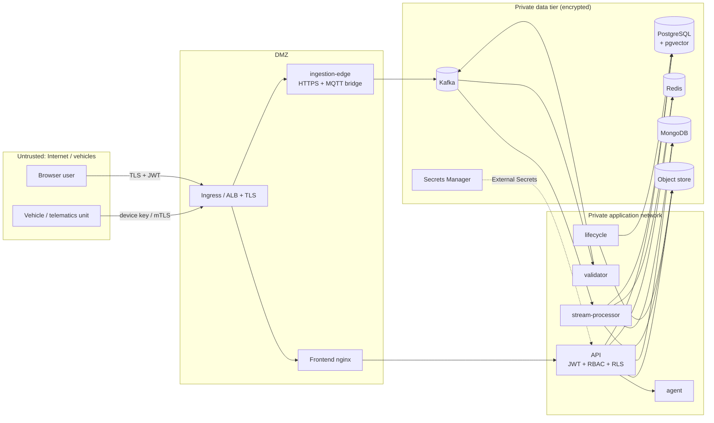

# STRIDE threat model

Scope: the Connected Vehicle Intelligence platform as deployed by `docker-compose.yml` / Kubernetes / Terraform. Data is synthetic, but
the model assumes real fleet data (location is personal data in many jurisdictions).

## 1. System and trust boundaries

Assets: tenant isolation, location/telemetry data, credentials and tokens, audit-log integrity, availability of ingestion/alerting,
the integrity of alerts and ML outputs, the agent's ability to act.

## 2. Threats and mitigations

### S — Spoofing
| # | Threat | Mitigation | Evidence |
|---|---|---|---|
| S1 | Attacker posts telemetry as someone else's vehicle | Edge requires a device key (constant-time compare; per-device mTLS/certs recommended in production). Validator rejects bad VINs (ISO 3779 check digit); the processor rejects events whose `tenant` does not match the vehicle's tenant → DLQ `tenant_mismatch` | `tests/unit/test_processor.py::test_malformed_unknown_and_spoofed_tenant_go_to_dlq`, `tests/unit/test_edge_and_stores.py` |
| S2 | Forged/expired/replayed user token | HS256/RS256 JWT with issuer+audience+expiry validation, `alg=none` rejected, access vs refresh type, refresh-token rotation with revocation set | `tests/unit/test_agent_and_security.py::test_jwt_validation_*`, `tests/integration/test_api.py::test_refresh_token_rotation_rejects_reuse` |
| S3 | Credential stuffing / brute force | bcrypt, uniform error message, timing-equalised unknown-user path, 5-failure lockout (5 min), IP/token rate limit | `test_login_failures_are_uniform_and_lock_out_*` |
| S4 | Rogue MQTT publisher | MQTT listener is private in compose; production: TLS 8883 + per-device credentials/ACLs on `telemetry/<tenant>/<vin>` | docs/deployment.md |

### T — Tampering
| # | Threat | Mitigation | Evidence |
|---|---|---|---|
| T1 | Edit/delete audit records to hide actions | Append-only privileges for the API role; per-tenant SHA-256 hash chain verified on read | `tests/integration/test_database.py::test_audit_log_hash_chain_detects_tampering`, `::test_api_role_cannot_modify_or_delete_audit_rows` |
| T2 | Tamper with agent trail | Same chain on `agent_audit` | `test_agent_audit_trail_records_every_step_and_is_tamper_evident` |
| T3 | Modify events in transit | TLS at ingress/ALB, TLS to MSK/ElastiCache/RDS/DocumentDB (Terraform) | infrastructure/terraform |
| T4 | Malicious payloads (SQL/NoSQL/JSON injection) | Parameterised SQL everywhere; strict Pydantic schemas (`extra=forbid`); fixed Mongo `_id` upserts; path-traversal check in the object store | `test_sql_injection_attempts_are_inert`, `test_local_object_store_rejects_path_traversal` |
| T5 | Replay/duplicate events to inflate aggregates | `event_id` idempotency gate (Redis Lua) | `test_duplicate_event_is_processed_once` |

### R — Repudiation
| # | Threat | Mitigation |
|---|---|---|
| R1 | A user denies acknowledging/resolving an alert or running a scenario | Every mutation writes `audit_log` (actor, action, resource, ip, details) inside the same tenant context |
| R2 | The agent "did something" nobody asked for | Destructive tools need a user-bound single-use token; `confirmation` steps are audited; all tool calls/results are in `agent_audit` |
| R3 | Erasure disputes | `erasure_requests` + report + audit entries |

### I — Information disclosure
| # | Threat | Mitigation | Evidence |
|---|---|---|---|
| I1 | Cross-tenant reads (IDOR, filter abuse) | Three layers: (1) every query carries `tenant_id`; (2) **PostgreSQL row-level security** with `FORCE ROW LEVEL SECURITY` and a non-owner `cvi_app` role (`app.tenant_id` set per transaction); (3) composite FKs prevent cross-tenant references. Foreign objects return **404**, not 403 | `test_row_level_security_isolates_tenants`, `test_object_level_access_to_another_tenants_records_is_404`, acceptance scenario "Tenants are isolated" |
| I2 | Precise location exposure | `location:precise` permission; others get the centre of a ~5 km geohash cell | `test_precise_location_is_masked_*` |
| I3 | Secrets in code/images | `.env` ignored, secrets from Secrets Manager/External Secrets, Trivy secret scan in CI, no credentials in logs | CI workflow |
| I4 | Verbose errors / stack traces | Generic 5xx responses, request-id correlation | `test_security_headers_cors_and_error_hygiene` |
| I5 | Agent data exfiltration / prompt injection | Tools are tenant-scoped; input screening; output scrubbing; grounding check on LLM text; tool outputs treated as data | `test_agent_blocks_prompt_injection_*`, `test_agent_never_returns_other_tenants_vehicles` |
| I6 | Data left behind after deletion requests | Erasure across Redis/Mongo/Parquet/PostgreSQL | `test_vehicle_erasure_removes_data_from_every_tier_and_is_audited` |

### D — Denial of service
| # | Threat | Mitigation |
|---|---|---|
| D1 | Request floods on the API | Redis token-bucket rate limit shared by replicas (in-process fallback if Redis is down), body-size limit (413), HPA, ingress `limit-rps` |
| D2 | Ingestion flood / burst | Edge only appends to Kafka; 503 + `Retry-After` when the broker is unhealthy (device-side back-off); Kafka absorbs bursts; HPA/KEDA scale consumers on lag |
| D3 | Poison messages stalling a partition | Bisection → DLQ; never blocks the partition |
| D4 | Slow/dead dependency cascades | Circuit breakers, back-pressure instead of unbounded queues, bounded buffers |
| D5 | Expensive queries | Keyset pagination, max page size 200, DB indexes, 2 s dashboard cache with stampede lock, agent per-user rate limit and max 6 tool calls |
| D6 | Agent/LLM cost abuse | Message length limit, rate limit, LLM optional with 20 s timeout and size-capped context |

### E — Elevation of privilege
| # | Threat | Mitigation |
|---|---|---|
| E1 | User calls an admin/write endpoint | Permission dependency on every route (`require("…")`), contract test proves every protected route returns 401 without a token; RBAC matrix tested |
| E2 | App DB credential misuse | `cvi_app` is non-superuser, `NOBYPASSRLS`, INSERT-only on audit tables; the owner role is used only by migrations; workers use a separate `BYPASSRLS` role with no UPDATE/DELETE on audit tables |
| E3 | Container breakout | Non-root user (uid 10001), read-only root FS, drop all capabilities, seccomp `RuntimeDefault`, NetworkPolicies default-deny |
| E4 | Agent performs write actions on its own | Write tools are `destructive`; only executed via `/agent/confirm` with permission `agent:act` |
| E5 | Token claims tampering (role escalation) | Signature verification; roles come from the signed token; `auth_lookup` re-reads roles on refresh |

## 3. Residual risks / accepted
* Device authentication in the demo is a shared key; production should use per-device certificates (mTLS) — documented, not implemented.
* The HS256 signing secret is shared by API replicas; for multi-service/multi-issuer setups use an external OIDC provider
  (`OIDC_JWKS_URL` enables RS256 validation).
* Materialised views have no RLS; they are only read by queries with an explicit `tenant_id` filter.
* In-process detector windows are not integrity-protected against a compromised worker.
* DAST (OWASP ZAP) and container scanning (Trivy) are wired into CI; they were not executed on the development laptop (no Docker).
